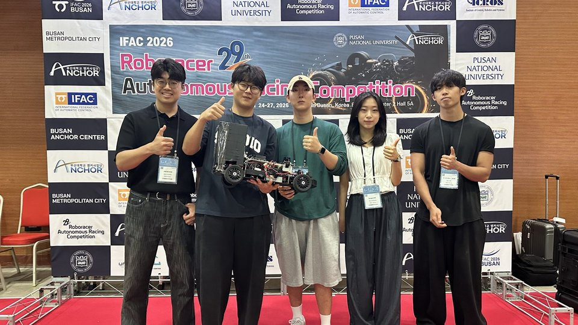
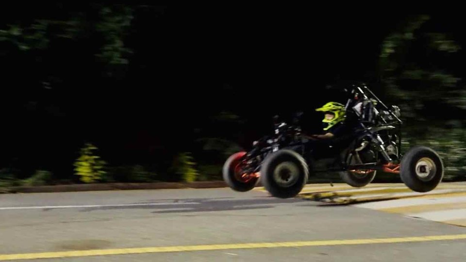
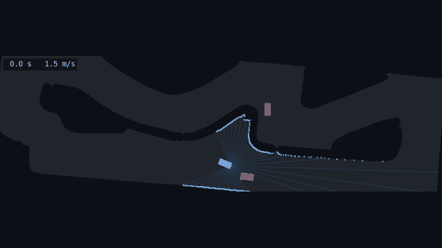
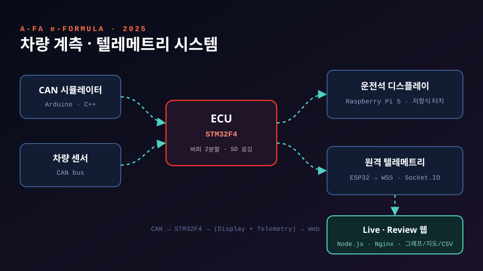
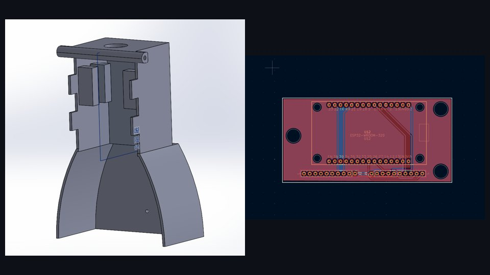

<!-- Header -->

 

## 🙋‍♂️ About Me

- 🎓 아주대학교 **기계공학과**
- 🎯 **차량용 임베디드 시스템 · ADAS** 엔지니어를 목표로 합니다
- 🏎️ **IFAC 2026 Roboracer 자율주행 레이싱** 본선 32강 · 경로 생성·추종·회피 파트 단독 담당
- 🏁 자작자동차 동아리 **A-FA** · BAJA(2026) / e-Formula(2025) 차량 계측 시스템
- 🔧 센서 선정 → 회로·PCB → MCU 펌웨어 → 실차 검증까지 **끝까지 직접** 해보는 걸 좋아합니다
- 📘 지금은 **C/C++ · Embedded C**를 기초부터 다시 다지는 중입니다

 

## 🗺️ Project Map

| | 🏎️ 자율주행 레이싱 | 🏁 BAJA 계측 | 🪰 Fly Racer | ⚡ e-Formula | 🚆 KORAIL |
|:---|:---:|:---:|:---:|:---:|:---:|
| **ADAS · 인지/판단/제어** | ✅ | | ✅ | | |
| **차량 계측 · DAQ** | | ✅ | | ✅ | ✅ |
| **차량 통신 (CAN · UART · I2C)** | ✅ | ✅ | | ✅ | ✅ |
| **MCU 펌웨어** | | ✅ | | ✅ | ✅ |
| **회로 · PCB** | | ✅ | | | ✅ |
| **실차 검증** | ✅ | ✅ | ✅ | ✅ | |

 

## 📌 Projects

<table>
<tr>
<td width="50%" valign="top">

### 🏎️ [자율주행 레이싱카 경로 추종·회피 스택](https://github.com/wowowowooon/Roboracer-2026)
IFAC 2026 제29회 Roboracer · 아주대 A:UTO · 2025.12 – 2026.08

1/10 자율주행 레이싱카에서 **Path Following 파트를 혼자 설계·구현·튜닝**했습니다.

- 🏆 **본선 진출 · 32강**
- 📐 최소곡률 레이스라인(볼록 QP) → 예상 랩타임 **−16%**
- 🛑 속도 기반 회피 기동 + TTC **AEB** → 777개 지점 시험에서 **벽 충돌 계획 0건**
- 🧪 단위 테스트 **501개** · GitHub Actions CI

     

</td>
<td width="50%" valign="top">

### 🏁 [BAJA 실시간 계측 · 서스펜션 최적화](https://github.com/wowowowooon/A-FA-2026-BAJA)
아주대 A-FA · 2026 KSAE 대학생 자작자동차대회 기술아이디어

오프로드 차량에 계측 시스템을 **직접 만들어 싣고**, 그 데이터로 서스펜션 세팅을 골랐습니다.

- 📉 실차 피치 변동폭 **10.70° → 5.50° (−48.6%)**
- 🔌 RPi + ESP32(ADC→I2C) + Teensy(ECU **CAN**) 통합 · 진동에 강한 **자체 PCB**
- 📡 MQTT → FastAPI → InfluxDB / WebSocket 실시간 대시보드
- 🛞 에어쇼바 실측 → 등가 강성식 → Altair 점프 해석

     

</td>
</tr>
<tr>
<td width="50%" valign="top">

### 🪰 [초파리 뇌 배선으로 달리는 1:10 자율주행차](https://github.com/wowowowooon/Fruit-fly-brain-reinforcement-learning)
커넥톰 강화학습 · Sim-to-Real · 2026.09 – 10

초파리 뉴런 871개 배선을 그대로 쓴 제어기를, **직접 구현한 시뮬레이터**로 학습시켜 실차에 올렸습니다.

- 🏁 학습에 안 쓴 대회 코스 **21/21 완주**
- 🧠 밀집망 대비 파라미터 **59배 적음**, 센서 고장·지연 등 처음 보는 조건에서 더 강건
- 🚗 **Jetson Xavier NX 실차 주행 성공** (라이다 + IMU만 사용, 지도 없음)

    

</td>
<td width="50%" valign="top">

### ⚡ [e-Formula 차량 텔레메트리 시스템](https://github.com/A-FA-2025/monolith)
아주대 A-FA · 2025 자작자동차대회 · 팀 프로젝트

STM32F4 ECU가 받은 CAN 데이터를 **운전석 디스플레이와 원격 서버로 동시에** 보내는 계측 플랫폼입니다.

- 🖥️ RPi 5 운전석 디스플레이 (장갑 착용 고려한 저항식 터치)
- 📡 ESP32 → WSS/Socket.IO → 웹 실시간 모니터링 · 로그 리뷰
- 🧪 가상 CAN 데이터를 쏘는 **시뮬레이터**로 수신 로직 사전 검증

    

</td>
</tr>
<tr>
<td width="50%" valign="top">

### 🚆 [KORAIL 연결기 높이 측정기](https://github.com/wowowowooon/KORAIL-Measuring-instrument)
휴대형 측정 장치 · 기구 · PCB · 펌웨어

레이저 거리센서 2개와 궤간(1435 mm)만으로 철도차량 연결기 높이를 재는 장치를 **혼자 처음부터 끝까지** 만들었습니다.

- 📏 각도 없이 세 변으로 높이 계산 → 레이저 각도 바뀌어도 재보정 불필요
- 🔍 센서 3차 비교 → ±1 mm 성능을 약 **1/5 가격**으로
- 🛡️ 이상값 차단 · 응답 없는 센서 자동 재시작 · 최소제곱 보정 도구

    

</td>
<td width="50%" valign="top">

### 📘 [C/C++ · Embedded C Study](https://github.com/wowowowooon/C-study)
진행 중 · C++17 / C11

하드웨어는 많이 만들어 봤지만, 펌웨어를 **AI 없이 직접 읽고 쓰는 힘**을 키우려고 처음부터 다시 쌓고 있습니다.

- 📖 언어 기초 → 알고리즘(프로그래머스 Lv.3) → 임베디드 C
- 🔧 목표: `volatile` · ISR · 링 버퍼 · 상태 머신 · PID · CAN 파싱 직접 구현

  

</td>
</tr>
</table>

 

## 🛠️ Tech Stack

| 분야 | 기술 |
|:---|:---|
| **MCU / SBC** |        |
| **Vehicle Network** |      |
| **ADAS / Robotics** |       |
| **Control / Planning** |      |
| **Language** |     |
| **Hardware / CAE** |    |
| **Data / Server** |      |
| **Dev** |     |

 

## 📊 GitHub Stats

  
  
  

 

## 📫 Contact

